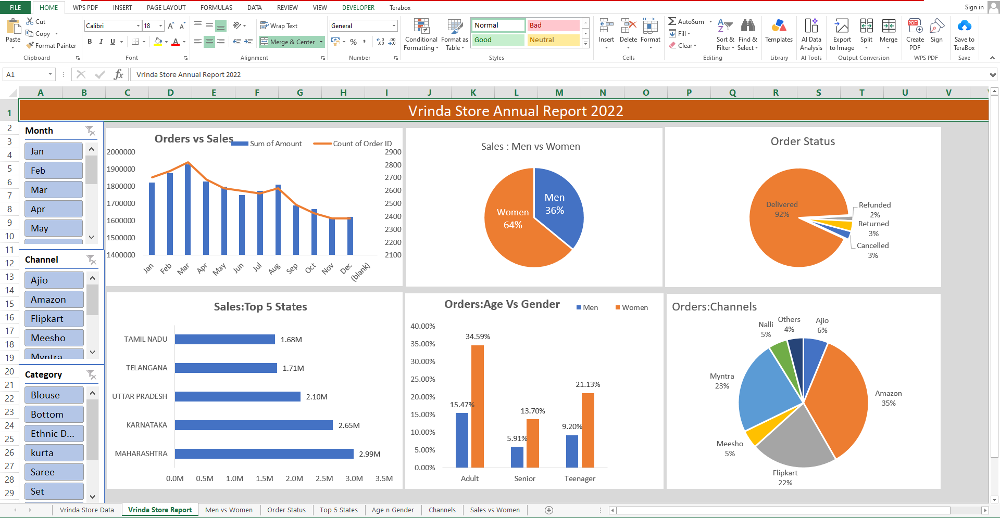
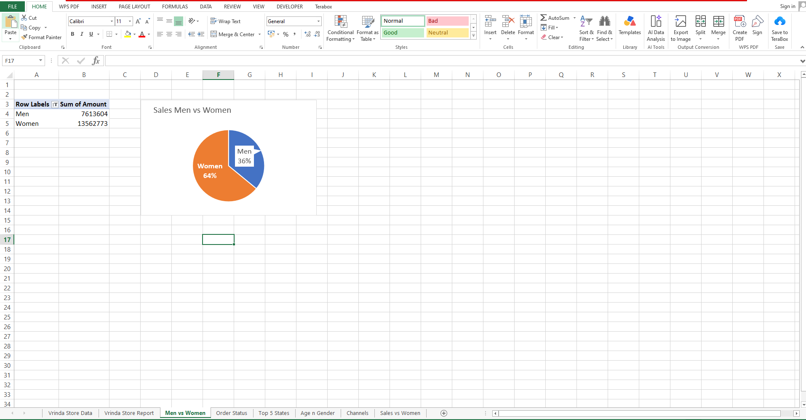
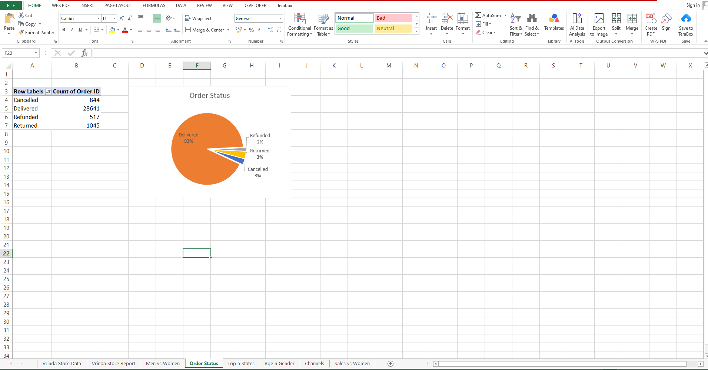
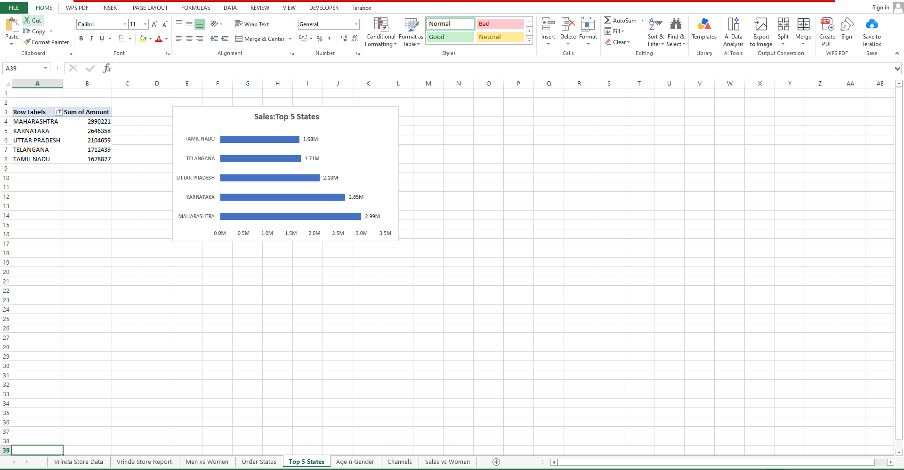
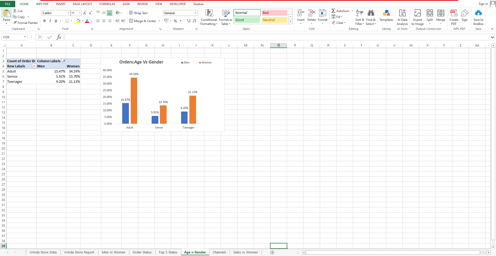
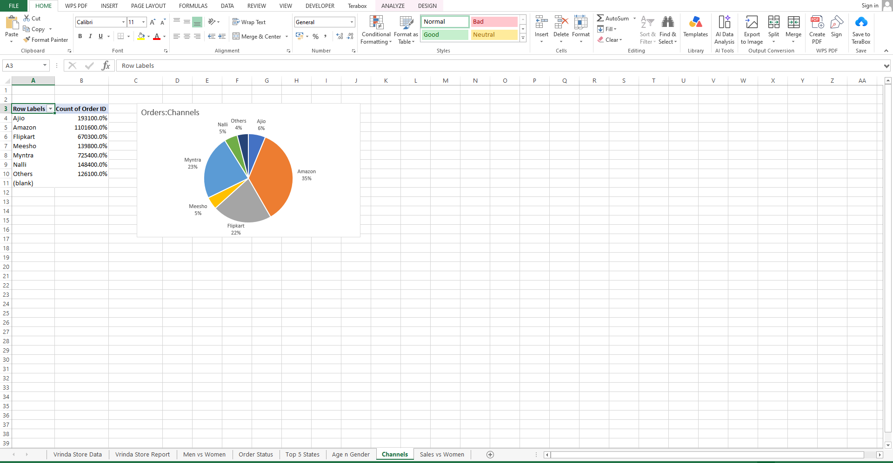

# Vrinda Store Annual Report 2022 — Excel Data Analysis

## Project Overview
An Excel-based data analysis project exploring Vrinda Store's annual sales and order performance for 2022.

## Tools Used
- Microsoft Excel
- PivotTables and PivotCharts
- Interactive dashboard filters
- Charts and data visualization

## Dashboard Preview

## Analysis and Insights

### 1. Sales: Men vs Women

Women contributed approximately 64% of sales, compared with 36% for men in the displayed report.

### 2. Order Status

Approximately 92% of orders were delivered in the displayed report.

### 3. Top 5 States by Sales

Maharashtra ranked first among the five displayed states.

### 4. Orders by Age and Gender

The chart compares order shares for Adult, Senior, and Teenager groups by gender.

### 5. Sales Channels

Amazon had the largest order share in the displayed channel chart.

### 6. Monthly Sales and Orders

The chart compares monthly sales amounts and order counts from January to December.

## Interactive Dashboard
The main dashboard includes Month, Channel, and Category filters for exploring the available reports.

## Project File
[Download or view the Excel workbook](Vrinda%20Store%20Data_Analysis.xlsx)

## Author
Akshay Mahadik
